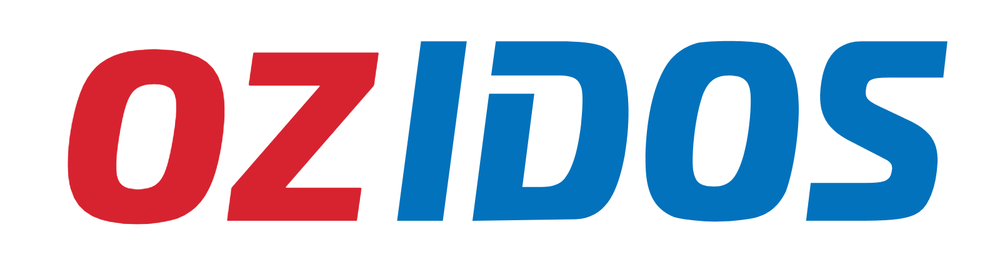
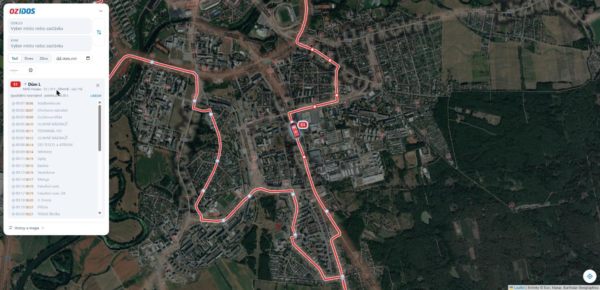
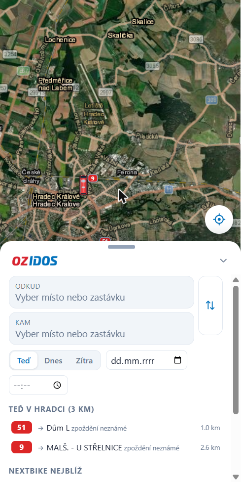
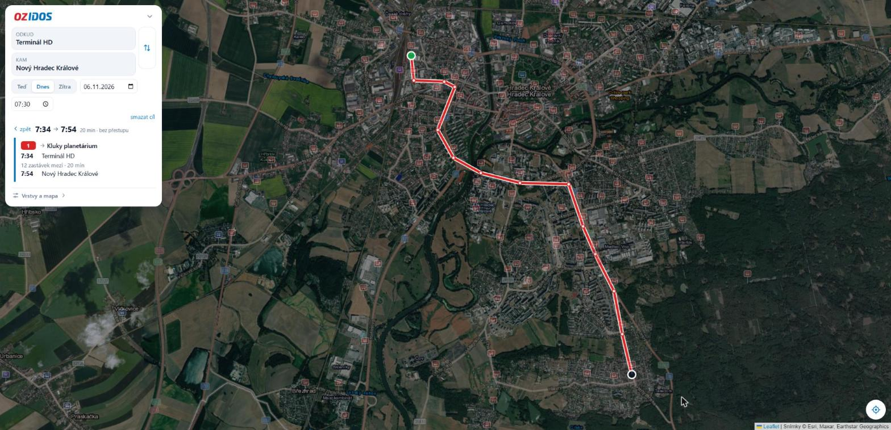

  

<h3 align="center">Konečně víš, proč mrzneš na zastávce.</h3>

  Spojení, odjezdy a <b>živá poloha každého autobusu</b> v Hradci Králové a okolí. 
  Na jedné mapě. V telefonu. Zdarma.

  <a href="https://oondraa.github.io/ozidos/"><b>Otevřít OZIDOS</b></a>

  
  
  
  

  

---

## Klasický vyhledávač ti řekne, kdy bus pojede. OZIDOS ti ukáže, kde zrovna je.

Stojíš na zastávce, bus má podle jízdního řádu tři minuty zpoždění a ty nevíš, jestli ještě přijede.
S OZIDOS ho vidíš na mapě: kde právě je, jak se blíží a jestli nabírá zpoždění.

## Co umí

### Najde spojení odkudkoli kamkoli
Z tvé polohy, ze zastávky nebo z libovolného místa na mapě. MHD, regionální busy i vlaky v jednom.
Dnes, zítra nebo kterýkoli den, s dřívějšími a pozdějšími spoji na jedno klepnutí.

### Živé autobusy na satelitní mapě
Každý bus MHD Hradec Králové i IREDO jako malý model, natočený po směru jízdy.
Barva štítku ti řekne, jestli jede včas, nebo nabírá zpoždění.

### „Vyraz za 4 minuty“
Žádné počítání. OZIDOS ti řekne, kdy vyjít, aby sis to stihl, a připočítá i cestu pěšky na zastávku.

### Odjezdy z každé zastávky
Klepni na zastávku a hned vidíš, co z ní jede, kam a v kolik.

### Trasa každého spoje
Klepni na bus a uvidíš celou jeho trasu, zastávky a které už projel.

### Nextbike na jednom místě
Kde stojí kola a kolik jich tam je, přímo v mapě.

### Tvůj domov, jen tvůj
Nastav si domov a cesta domů je na jedno klepnutí. Domov zůstane jen v tvém telefonu, nikam se neposílá.

  
  &nbsp;&nbsp;
  

## Udělaný pro telefon

- Panel se tahá prstem jako v mapových aplikacích, mapa zůstane vidět.
- Přidej si OZIDOS na plochu a otevírá se jako aplikace.
- Jízdní řády se každé ráno samy aktualizují.

## Vyzkoušej to

1. Otevři **[oondraa.github.io/ozidos](https://oondraa.github.io/ozidos/)** v telefonu.
2. Povol polohu.
3. Napiš, kam jedeš.

Hotovo. Bez registrace, bez reklam, bez placení.

---

Neoficiální projekt, není spojený s DPmHK, IREDO ani Nextbike. Jízdní řády: CIS JŘ (zpracování spojenka.cz). Mapové podklady: Esri, © přispěvatelé OpenStreetMap.
